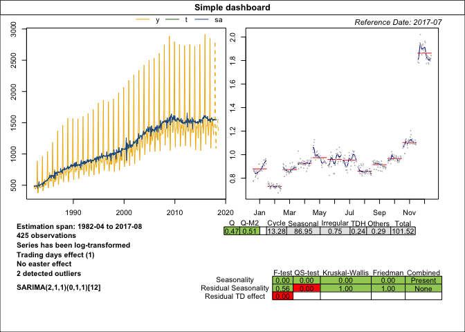
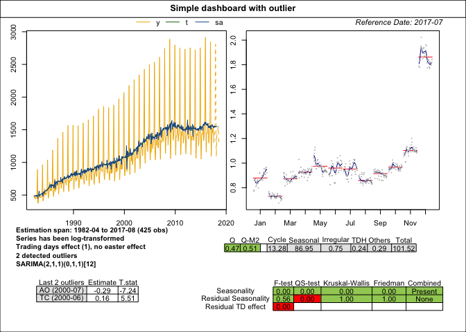

<!-- README.md is generated from README.Rmd. Please edit that file -->

# rjd3report

<!--  -->

<!-- [](https://github.com/AQLT/rjdqa/actions) -->

<!-- [](https://cran.r-project.org/package=rjdqa) -->

<!-- [](https://cran.r-project.org/package=rjdqa) -->

<!-- [](https://cran.r-project.org/package=rjdqa) -->

<!-- [](https://cran.r-project.org/package=rjdqa) -->

## Overview

rjd3report is an extension of the R packages around JDemetra+ 3.x
available at <https://github.com/rjdverse>. The rjd3report package
provides help to the quality assessment by producing different
dashboards and reports (with [Quarto](https://quarto.org)) describing
seasonal adjustment models.

## Installation

rjd3report requires Java SE 21 or later version. To render reports,
[Quarto](https://quarto.org) must also be installed.

``` r
# Install development version from GitHub
# install.packages("devtools")
remotes::install_github("AQLT/rjd3report")
```

# Usage

<!-- ## Create Statistics Canada dashboard -->

<!-- The function `sa_dashboard()` reproduces Statistics Canada dashboard. -->

<!-- See : -->

<!-- KIRCHNER R., LADIRAY D., MAZZI G. L. (2018), "Quality Measures and Reporting for Seasonal Adjustment", edited by G. L. Mazzi, co-edited by D. Ladiray, European Union, Luxembourg. <https://ec.europa.eu/eurostat/web/products-manuals-and-guidelines/-/KS-GQ-18-001> -->

<!-- MATTHEWS S. (2016), "Quality Assurance of Seasonal Adjustment for a Large System of Time Series", 36th International Symposium on Forecasting Santander, Spain. -->

<!-- ```{r stat_cana_dash, fig.height = 8, fig.width = 10} -->

<!-- library(RJDemetra) -->

<!-- library(rjdqa) -->

<!-- sa_model <- x13(ipi_c_eu[, "FR"], "RSA5c") -->

<!-- dashboard_data <- sa_dashboard(sa_model) -->

<!-- plot(dashboard_data, main = "Statistics Canada dashboard", -->

<!--      subtitle = "SA with X13") -->

<!-- ``` -->

## Simple dashboard

``` r
library(rjd3report)
y <- rjd3toolkit::ABS$X0.2.09.10.M
sa_mod <- rjd3x13::x13(y)
dashboard_data <- simple_dashboard(sa_mod)
plot(dashboard_data, main = "Simple dashboard")
```



``` r
dashboard_data2 <- simple_dashboard2(sa_mod)
plot(dashboard_data2, main = "Simple dashboard with outlier")
```



## Reports

`sa_preprocessing()`, `sa_decomposition()` and `sa_diagnostics()`
describe a seasonal adjustment model; `sa_report()` gathers them (with
plots) for one model, a list of models or a whole workspace. In a Quarto
(or R Markdown) document, the results are rendered automatically
whatever the output format (HTML, PDF with LaTeX or Typst, Word): no
`results: asis` nor `format` argument needed. The tables are built with
[tinytable](https://vincentarelbundock.github.io/tinytable/).

``` r
sa_ts <- rjd3tramoseats::tramoseats(y)
# In a chunk of a Quarto document:
sa_diagnostics(sa_mod)
sa_report(list(X13 = sa_mod, `TRAMO-SEATS` = sa_ts))

# Directly render a report from a Quarto template:
render_report(list(X13 = sa_mod, `TRAMO-SEATS` = sa_ts), "report.html")
render_report("path/to/workspace.xml", "report.pdf", output_format = "typst")
# To customize the template:
use_report_template("my_template.qmd")
```
